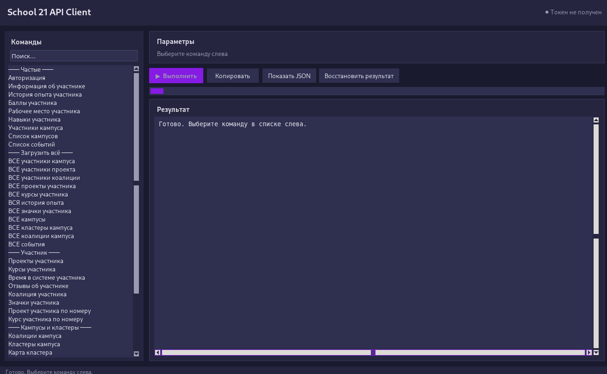

# School 21 API Client

Программа для работы с API School 21. Показывает данные в удобном виде.



## Что умеет

- 37 команд: авторизация, кампусы, участники, проекты, курсы, события и другие.
- Тёмная тема, поиск по командам.
- Выпадающие списки для выбора статуса, типа, занятости.
- Поиск по логину и названию прямо в программе.
- Даты показываются в нормальном виде (23.01.2024 10:00).
- Таблицы с выравниванием, пустые поля показаны как «—».
- Параметры и результат сохраняются при переключении команд.
- Подсказки под каждым полем.

## Установка на Linux

1. Установите Python (если нет):
   - Ubuntu/Debian: `sudo apt install python3 python3-pip python3-tk`
   - Fedora: `sudo dnf install python3 python3-pip python3-tkinter`
   - Arch: `sudo pacman -S python python-pip tk`

2. Скачайте проект:
   ```bash
   git clone https://github.com/horek111/school_21_python_api_gui_app.git
   cd school_21_python_api_gui_app
   ```

3. Установите библиотеки:
   ```bash
   pip3 install -r requirements.txt
   ```

4. Запустите:
   ```bash
   python3 s21_api_app.py
   ```

Если не работает pip3, попробуйте: `python3 -m pip install -r requirements.txt`

## Установка на Windows

1. Скачайте Python с https://www.python.org/downloads/
   - При установке поставьте галочку «Add python.exe to PATH».

2. Скачайте проект:
   - Нажмите зелёную кнопку Code → Download ZIP на странице проекта.
   - Распакуйте в любую папку.

3. Откройте командную строку (Win + R → cmd) и перейдите в папку проекта:
   ```cmd
   cd C:\путь\к\папке
   ```

4. Установите библиотеки:
   ```cmd
   pip install -r requirements.txt
   ```

5. Запустите:
   ```cmd
   python s21_api_app.py
   ```

Если python не найден — переустановите Python с галочкой «Add to PATH».

## Как пользоваться

1. Запустите программу.
2. Нажмите «Авторизация» — введите логин и пароль School 21.
3. Выберите команду слева (можно искать по названию).
4. Заполните поля (под каждым есть подсказка).
5. Нажмите «Выполнить».
6. Результат появится справа.

Кнопки:
- **Копировать** — копирует результат.
- **Показать JSON / Показать красиво** — переключает вид.
- **Восстановить результат** — показывает сохранённый результат.

## Формат дат

Можно писать просто дату — время подставится автоматически (00:00):
- `2024-01-23`
- `23.01.2024`
- `23/01/2024`

## Типы событий

- `ACTIVITY` — мероприятие
- `EXAM` — экзамен
- `TEST` — тест
- пусто — все типы

## Статусы

`ASSIGNED`, `REGISTERED`, `IN_PROGRESS`, `IN_REVIEWS`, `ACCEPTED`, `FAILED`.

## Команды с автозагрузкой («ВСЕ …»)

Автоматически загружают все страницы и показывают полный список:
- ВСЕ участники кампуса / проекта / коалиции
- ВСЕ проекты / курсы / значки / история опыта
- ВСЕ кампусы / кластеры / коалиции
- ВСЕ события

## Как найти ID проекта

ID проекта — это число (например, `73494` или `134411`). Его можно получить:

1. Выполните команду **«Проекты участника»** (или **«ВСЕ проекты участника»**).
2. Введите свой логин.
3. В результате будет список проектов — у каждого есть поле **«ID»**.
4. Скопируйте нужный ID и используйте в командах **«Проект по номеру»** или **«Участники проекта»**.

Также ID проекта виден в команде **«Карта проектов»** (поле `entityId` у элементов с `entityType: PROJECT`).

## Ссылка

https://github.com/horek111/school_21_python_api_gui_app
